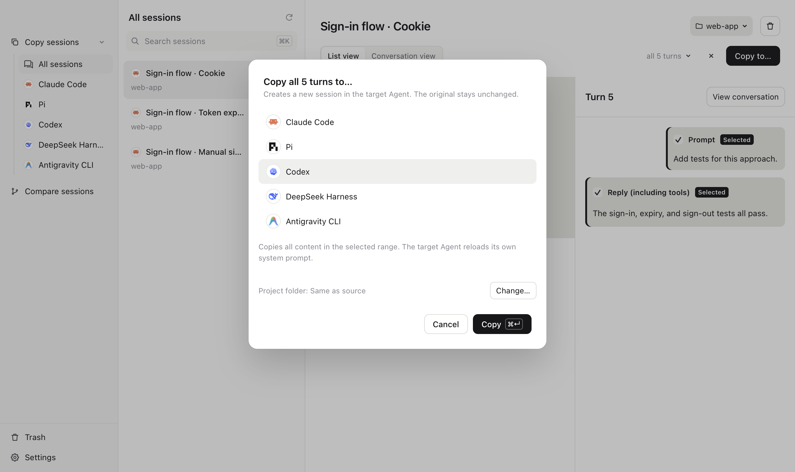
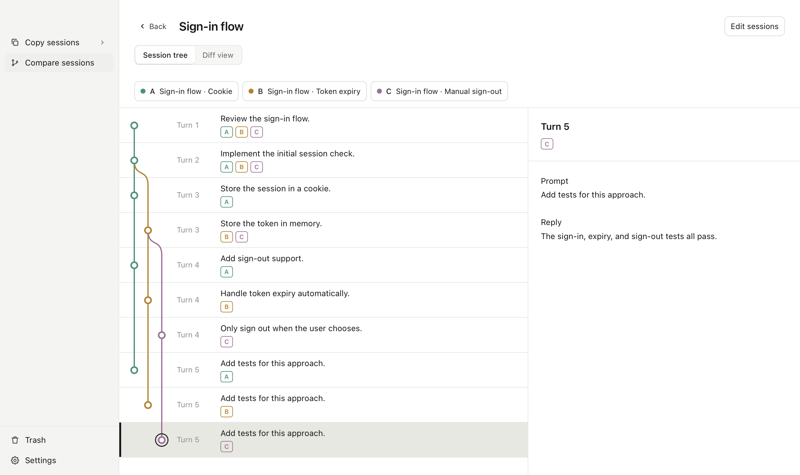

# koto

[English](README.md) · [简体中文](docs/zh/README.md) · [繁體中文](docs/zh-TW/README.md) · [日本語](docs/ja/README.md) · [Deutsch](docs/de/README.md)

**Switch agents. Keep talking.**

Copy sessions between agents. Compare them with a session tree and diff.

<picture>
  <source media="(prefers-color-scheme: dark)" srcset="site/assets/screenshots/en-dark-copy.png">
  
</picture>

<picture>
  <source media="(prefers-color-scheme: dark)" srcset="site/assets/screenshots/en-dark-tree.png">
  
</picture>

Works with Claude Code (including Desktop Code), Codex, pi, DeepSeek Harness, and Antigravity CLI. More agents coming soon.

There’s also koto CLI. 
Copy a session. Just ask.

> You: Use koto to copy this session to pi.
>
> Agent: Copied 5 turns to pi. 
> Open the copied session in pi with this command: 
> `cd <project> && pi --session <new-session-id>`

[Usage](docs/usage.md) · [Compatibility](docs/compatibility.md) · [Development](docs/development.md) · [Contributing](CONTRIBUTING.md)

[MIT License](LICENSE) · [Third-party notices](THIRD_PARTY_NOTICES.md)
