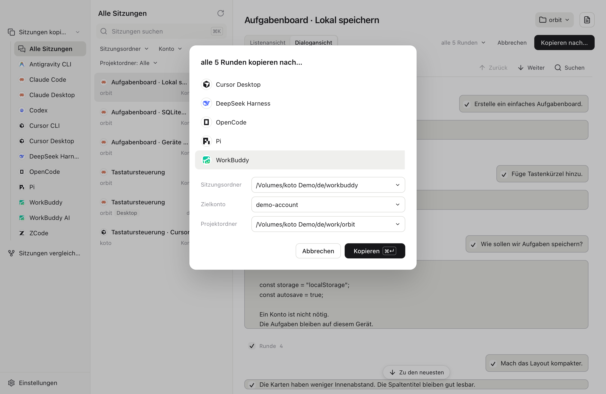
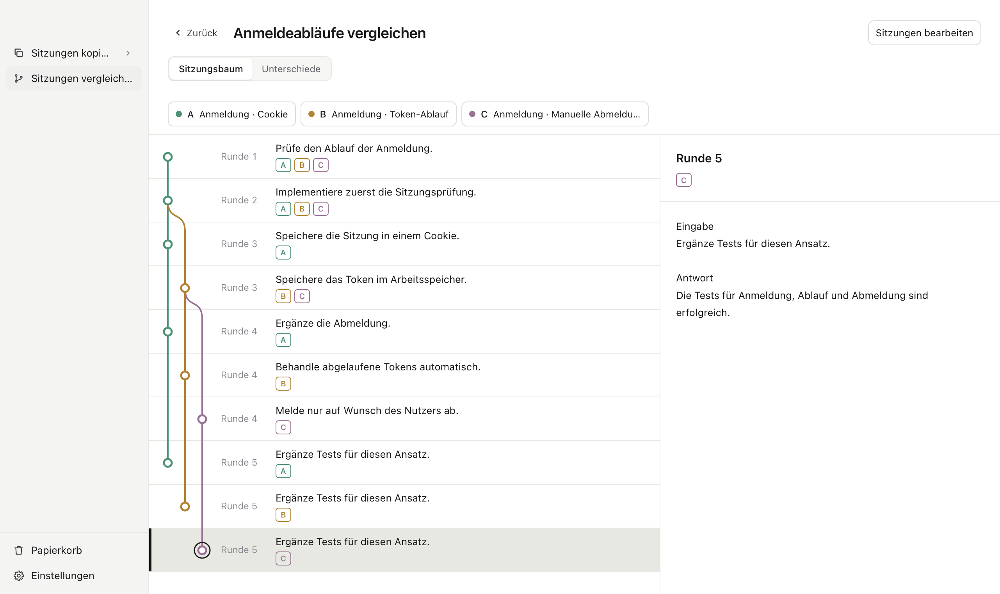

# koto

[English](../../README.md) · [简体中文](../zh/README.md) · [繁體中文](../zh-TW/README.md) · [日本語](../ja/README.md) · [Deutsch](README.md)

**Agent wechseln. Gespräch fortsetzen.**

Gespräche zwischen Agents kopieren. Sitzungen mit Baumansicht und Diff vergleichen.

[Download](https://github.com/Seanium/koto/releases/latest) · [Website](https://kotoai.site/)

<picture>
  <source media="(prefers-color-scheme: dark)" srcset="../../site/assets/screenshots/de-dark-copy.png">
  
</picture>

<picture>
  <source media="(prefers-color-scheme: dark)" srcset="../../site/assets/screenshots/de-dark-tree.png">
  
</picture>

Für Antigravity CLI, Claude Code, Claude Desktop, Codex, Cursor CLI, Cursor Desktop, DeepSeek Harness, OpenCode, pi, WorkBuddy (China und international) und ZCode. Weitere Agents folgen bald.

Auch mit koto CLI. 
Kopieren. Ein Satz genügt.

> Du: Kopiere dieses Gespräch mit koto nach pi.
>
> Agent: 5 Runden nach pi kopiert. 
> Öffne die kopierte Sitzung in pi mit diesem Befehl: 
> `cd <Projektpfad> && pi --session <neue-Sitzungs-ID>`

[Nutzung](usage.md) · [Kompatibilität](compatibility.md) · [Entwicklung](development.md) · [Mitwirken](contributing.md)

[MIT-Lizenz](../../LICENSE) · [Drittanbieterhinweise](../../THIRD_PARTY_NOTICES.md)
