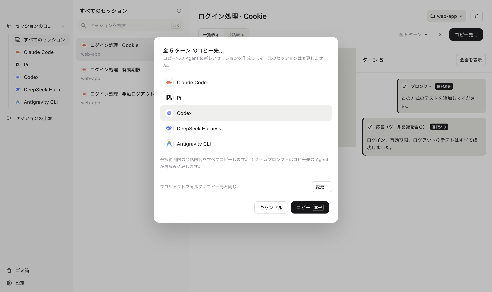
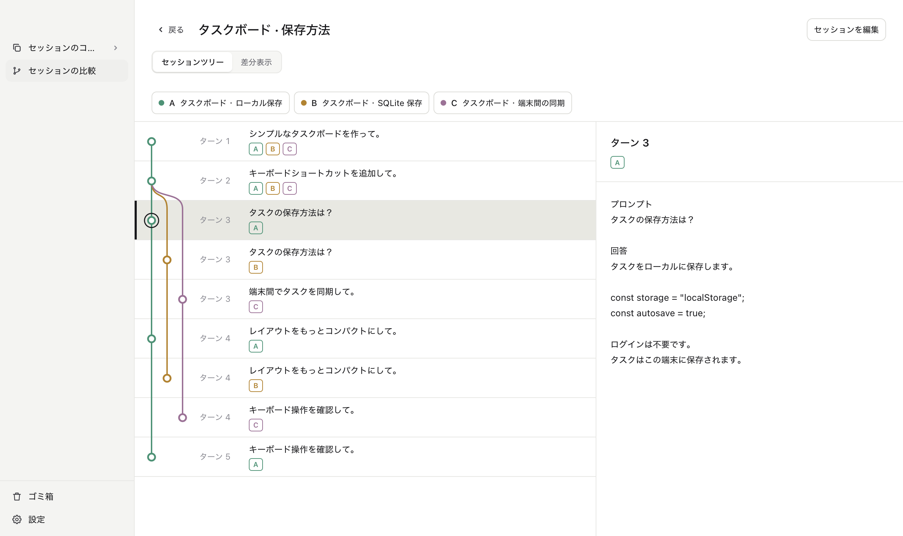

# koto

[English](../../README.md) · [简体中文](../zh/README.md) · [繁體中文](../zh-TW/README.md) · [日本語](README.md) · [Deutsch](../de/README.md)

**Agent を変えて、対話の続きを。**

対話を別の Agent にコピー。ツリーと diff でセッションを比較。

<picture>
  <source media="(prefers-color-scheme: dark)" srcset="../../site/assets/screenshots/ja-dark-copy.png">
  
</picture>

<picture>
  <source media="(prefers-color-scheme: dark)" srcset="../../site/assets/screenshots/ja-dark-tree.png">
  
</picture>

Claude Code（Desktop Code を含む）、Codex、pi、DeepSeek Harness、Antigravity CLI、OpenCode に対応。さらに多くの Agent に近日対応。

koto CLI も。 
コピーは、ひと言で。

> あなた：koto で今の対話を pi にコピーして。
>
> Agent：5 ターンを pi にコピーしました。 
> コピーした対話を pi で開くには、このコマンドを使ってください： 
> `cd <プロジェクトパス> && pi --session <新しいセッションID>`

[使い方](usage.md) · [互換性](compatibility.md) · [開発](development.md) · [貢献](contributing.md)

[MIT ライセンス](../../LICENSE) · [第三者の権利表示](../../THIRD_PARTY_NOTICES.md)
