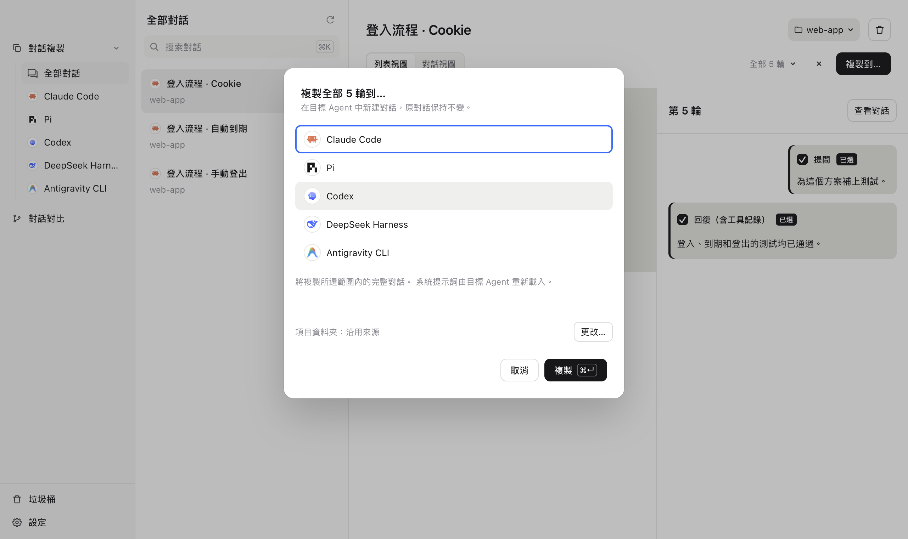
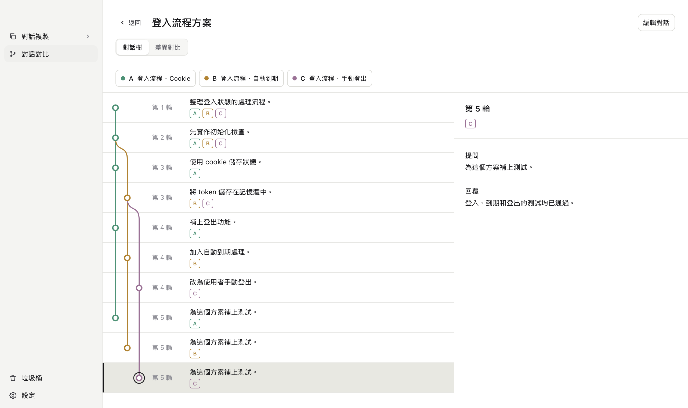

# koto

[English](../../README.md) · [简体中文](../zh/README.md) · [繁體中文](README.md) · [日本語](../ja/README.md) · [Deutsch](../de/README.md)

**換個 Agent，接著聊。**

把對話複製到另一個 Agent。用樹狀檢視和 diff 比較對話。

<picture>
  <source media="(prefers-color-scheme: dark)" srcset="../../site/assets/screenshots/zh-TW-dark-copy.png">
  
</picture>

<picture>
  <source media="(prefers-color-scheme: dark)" srcset="../../site/assets/screenshots/zh-TW-dark-tree.png">
  
</picture>

支援 Claude Code（含 Desktop Code）、Codex、pi、DeepSeek Harness 和 Antigravity CLI。還有更多，即將到來。

還有 koto CLI， 
複製，一句話的事。

> 你：用 koto 複製目前的對話到 pi
>
> Agent：已複製 5 輪到 pi。 
> 用這個指令開啟 pi 中複製好的對話： 
> `cd <專案路徑> && pi --session <新工作階段ID>`

[使用指南](usage.md) · [相容性](compatibility.md) · [開發指南](development.md) · [參與貢獻](contributing.md)

[MIT 授權條款](../../LICENSE) · [第三方聲明](../../THIRD_PARTY_NOTICES.md)
