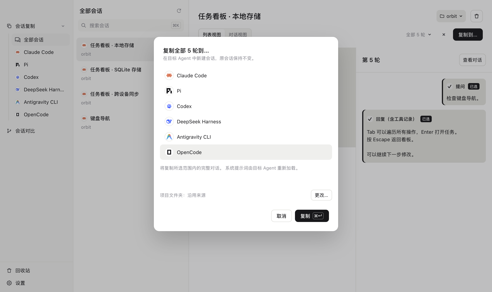
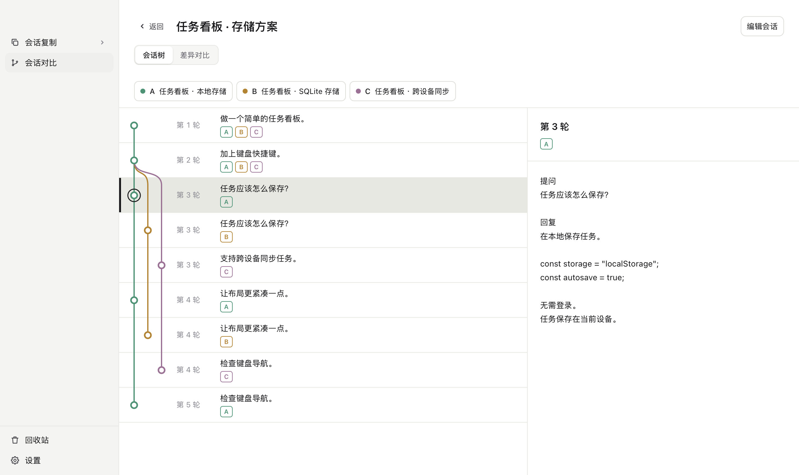

# koto

[English](../../README.md) · [简体中文](README.md) · [繁體中文](../zh-TW/README.md) · [日本語](../ja/README.md) · [Deutsch](../de/README.md)

**换个 Agent，接着聊。**

把会话复制到另一个 Agent。用会话树和 diff 对比会话。

[下载](https://github.com/Seanium/koto/releases/latest) · [网站](https://kotoai.site/)

<picture>
  <source media="(prefers-color-scheme: dark)" srcset="../../site/assets/screenshots/zh-dark-copy.png">
  
</picture>

<picture>
  <source media="(prefers-color-scheme: dark)" srcset="../../site/assets/screenshots/zh-dark-tree.png">
  
</picture>

支持 Claude Code（含 Desktop Code）、Codex、pi、DeepSeek Harness、Antigravity CLI 和 OpenCode。还有更多，即将到来。

还有 koto CLI， 
复制，一句话的事。

> 你：用 koto 复制当前会话到 pi
>
> Agent：已复制 5 轮到 pi。 
> 用这条命令打开 pi 中复制好的会话： 
> `cd <项目路径> && pi --session <新会话ID>`

[使用指南](usage.md) · [兼容性](compatibility.md) · [开发指南](development.md) · [参与贡献](contributing.md)

[MIT 许可证](../../LICENSE) · [第三方声明](../../THIRD_PARTY_NOTICES.md)
